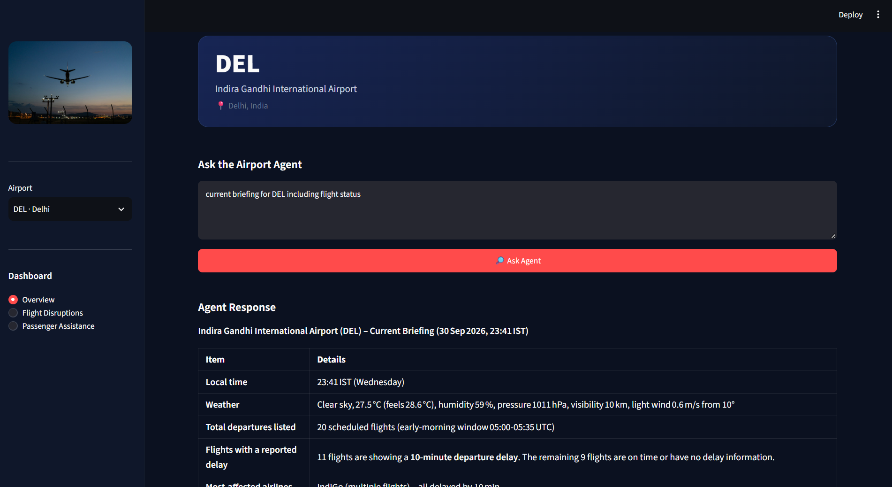
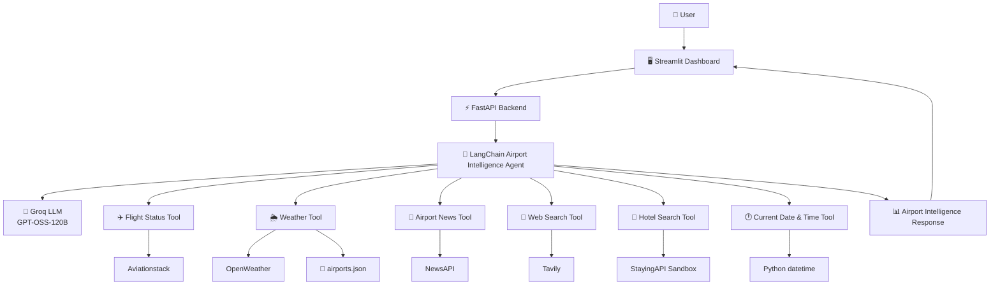
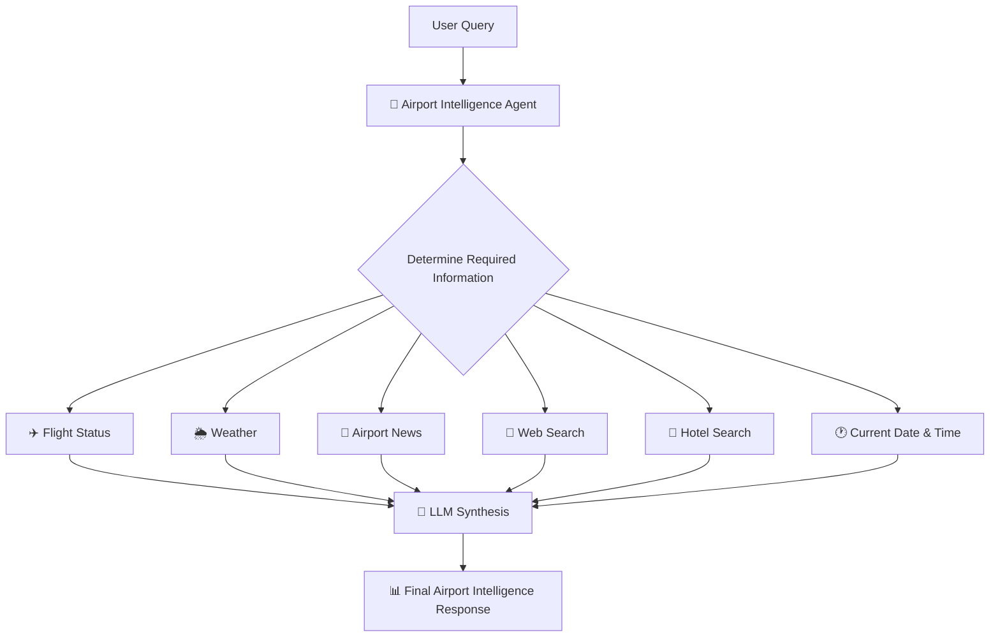
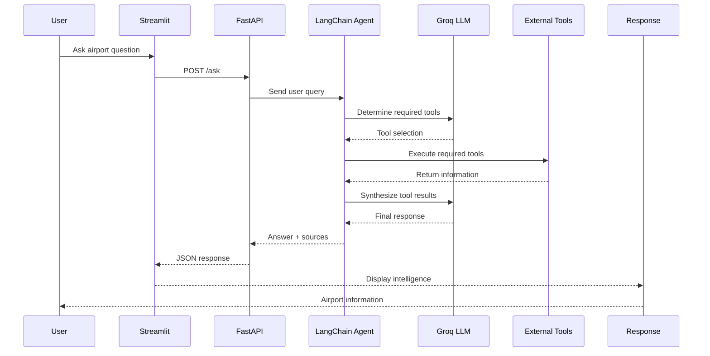
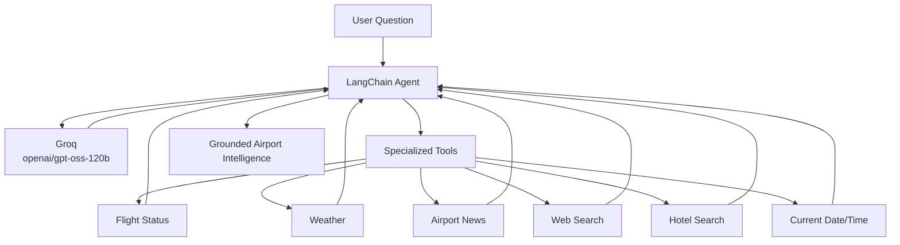
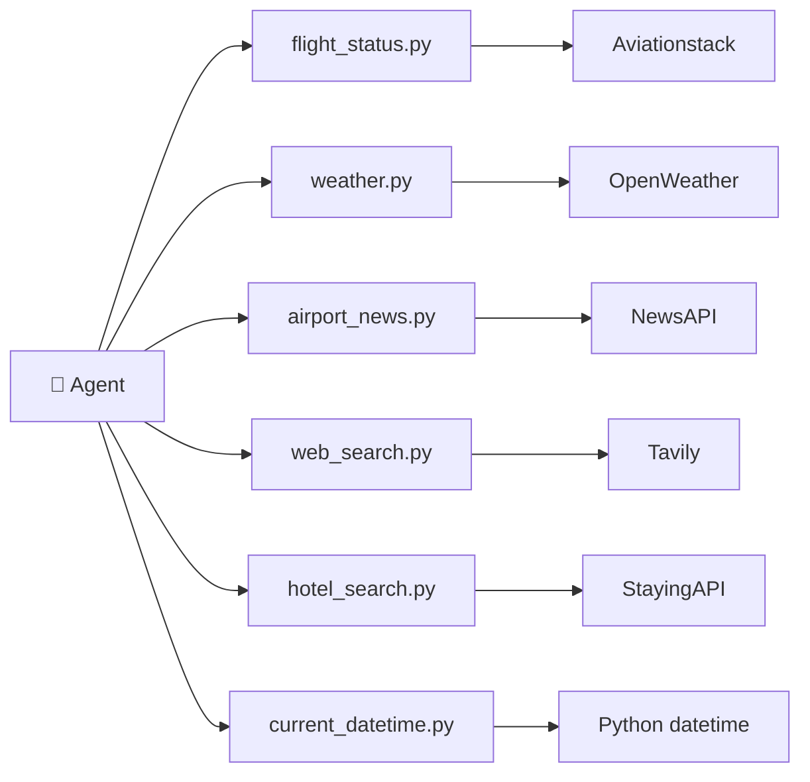

# ✈️ AI Airport Intelligence & Assistance Agent

An AI-powered airport intelligence and assistance system that combines real-time flight information, weather data, airport news, web research, hotel search, and time-aware reasoning through a LangChain agent.

The system provides a single conversational interface for airport intelligence, flight disruption analysis, and passenger assistance.

---

## 📁 Project Structure

```text
ai-airport-intelligence-agent/
│
├── app.py
├── main.py
├── agent.py
├── prompts.py
├── airports.json
│
├── assets/
│   └── dashboard.png
│
├── tools/
│   ├── __init__.py
│   ├── flight_status.py
│   ├── weather.py
│   ├── airport_news.py
│   ├── web_search.py
│   ├── hotel_search.py
│   └── current_datetime.py
│
├── requirements.txt
├── .env
├── .env.example
├── .gitignore
└── README.md
```

---

## 🖥️ Dashboard Preview



The dashboard provides airport selection, intelligence categories, and a conversational interface for querying the AI airport agent.

---

# 🏗️ System Architecture



---

# 🤖 Agent Workflow

The agent determines which tools are required based on the user's question.



---

# 🔄 Request Flow



---

# ✈️ Features

## 1. Airport Intelligence Overview

Provides a consolidated airport briefing using multiple information sources.

Can combine:

- Current flight information
- Weather conditions
- Recent airport news
- Current date and time
- Relevant web information
- Operational observations based on available data

---

## 2. Flight Disruption Intelligence

The agent can investigate:

- Flight delays
- Cancellations
- Current flight statuses
- Scheduled vs estimated departure times
- Airport-specific disruptions
- Potential operational issues

Flight information is retrieved using Aviationstack.

---

## 3. Passenger Assistance

The agent can answer passenger-oriented questions involving:

- Airport information
- Travel-related information
- Airport disruptions
- Weather
- Current events
- Hotel searches
- General airport assistance

---

## 4. Airport News

Recent airport-related news is retrieved using NewsAPI.

The agent can use this information to identify:

- Airport incidents
- Operational announcements
- Travel disruptions
- Security-related developments
- Airport-related events

---

## 5. Web Research

Tavily provides broader web search capabilities when the information required is not covered by the specialized airport tools.

Examples:

- Current airport disruptions
- Travel advisories
- Airport procedures
- Airline-related developments
- General travel information

---

## 6. Weather Intelligence

Current weather conditions are retrieved using OpenWeather.

The system uses airport coordinates stored in `airports.json`.

Example information:

- Temperature
- Feels-like temperature
- Humidity
- Visibility
- Wind speed
- Wind direction
- Atmospheric pressure
- Weather conditions

---

## 7. Hotel Assistance

The project includes hotel search through StayingAPI Sandbox.

The sandbox is used for development and demonstration purposes.

> ⚠️ StayingAPI Sandbox returns mock/demo hotel data. These results should not be interpreted as confirmed real-world hotel availability.

---

## 8. Time-Aware Reasoning

The agent includes a Python-based current date/time tool.

It can determine the current time for a requested timezone and is useful for queries involving:

- today
- now
- currently
- tonight
- recently
- this morning
- this evening

Default timezone:

```text
Asia/Kolkata
```

---

# 🧠 AI Architecture

The project uses a single-agent architecture with specialized tools.



The agent uses specialized tools when external or current information is required instead of relying entirely on the language model's internal knowledge.

---

# 🛠️ Technology Stack

| Component | Technology |
|---|---|
| Frontend | Streamlit |
| Backend | FastAPI |
| Agent Framework | LangChain |
| LLM | Groq `openai/gpt-oss-120b` |
| Flight Data | Aviationstack |
| Weather | OpenWeather |
| News | NewsAPI |
| Web Search | Tavily |
| Hotel Search | StayingAPI Sandbox |
| Date & Time | Python `datetime` |
| Observability | LangSmith |
| Language | Python |

---

# 🔌 External APIs

| Service | Purpose | Environment Variable |
|---|---|---|
| Aviationstack | Flight information | `AVIATIONSTACK_API_KEY` |
| OpenWeather | Weather information | `OPENWEATHER_API_KEY` |
| NewsAPI | Airport news | `NEWSAPI_KEY` |
| Tavily | Web search | `TAVILY_API_KEY` |
| StayingAPI | Hotel search | `STAYINGAPI_KEY` |
| Groq | LLM | `GROQ_API_KEY` |
| LangSmith | Agent tracing | `LANGSMITH_API_KEY` |

---

# 🔐 Environment Variables

Create a `.env` file in the project root:

```env
GROQ_API_KEY=

TAVILY_API_KEY=
NEWSAPI_KEY=
LANGSMITH_API_KEY=

AVIATIONSTACK_API_KEY=
OPENWEATHER_API_KEY=
STAYINGAPI_KEY=

LANGSMITH_TRACING=true
LANGSMITH_PROJECT=ai-airport-intelligence-agent
```

Never commit `.env` to GitHub.

---

# 🚀 Installation

## 1. Clone the repository

```bash
git clone <repository-url>
cd ai-airport-intelligence-agent
```

## 2. Create a virtual environment

```bash
python -m venv venv
```

Activate it on Windows:

```bash
venv\Scripts\activate
```

---

## 3. Install dependencies

```bash
pip install -r requirements.txt
```

---

## 4. Configure API keys

Create `.env` in the project root and add the required API keys.

---

# ▶️ Running the Application

The project has two components:

- FastAPI backend
- Streamlit frontend

### Start FastAPI

```bash
uvicorn main:app --reload
```

Backend:

```text
http://127.0.0.1:8000
```

### Start Streamlit

Open another terminal:

```bash
streamlit run app.py
```

The Streamlit dashboard will open in the browser.

---

# 🔗 API Endpoint

The main backend endpoint is:

```http
POST /ask
```

Example request:

```json
{
    "query": "Are there any flight disruptions at Delhi airport?"
}
```

Example response:

```json
{
    "answer": "....",
    "sources": [
        "flight_status",
        "weather",
        "airport_news"
    ]
}
```

The `/` endpoint is provided as a simple backend health check.

---

# 🧩 Application Components

### `app.py`

Streamlit frontend.

Responsibilities:

- Airport selection
- Dashboard navigation
- User query input
- Backend communication
- Displaying agent responses
- Displaying tools used by the agent

### `main.py`

FastAPI backend.

Responsibilities:

- Expose the `/ask` endpoint
- Receive user queries
- Pass queries to the agent
- Return the agent response

### `agent.py`

Core AI agent.

Responsibilities:

- Initialize the Groq LLM
- Register tools
- Create the LangChain agent
- Execute the agent
- Track tools used by the agent

### `prompts.py`

Contains the system instructions for the airport agent.

Defines:

- Agent role
- Tool usage rules
- Grounding requirements
- Current-information handling
- Hotel sandbox limitations
- Response behavior

### `airports.json`

Static airport reference data containing:

- IATA airport code
- Airport name
- City
- Latitude
- Longitude

This avoids unnecessary API calls for static airport information.

---

# 🔧 Tool Architecture

Each external capability is implemented as a separate LangChain tool.



This keeps each integration isolated and makes the agent workflow easy to trace.

---

# 📊 Example Queries

### Airport Overview

```text
Give me a current intelligence briefing for Delhi Airport.
Check the current flight status, weather conditions, recent airport-related
news, and identify any significant disruptions or issues that passengers
should know about.
```

### Flight Disruptions

```text
Are there any current flight delays or cancellations at Delhi airport?
```

### Weather

```text
What is the current weather at Mumbai airport?
```

### Airport News

```text
What are the latest news developments related to Delhi airport?
```

### Passenger Assistance

```text
I have a flight from Delhi tonight. Are there any current airport issues
I should know about?
```

### Hotel Assistance

```text
Find hotels near Delhi airport for two adults from 5 October to 7 October.
```

---

# 📈 Observability

LangSmith is configured for agent tracing and observability.

It can be used to inspect:

- User queries
- Agent execution
- Tool calls
- Tool outputs
- LLM responses
- Overall execution flow

This is useful for debugging and understanding how the agent reaches its final response.

---

# ⚠️ Data Limitations

### Flight Data

Flight information depends on Aviationstack's available coverage and API limits.

### News

NewsAPI data is subject to the limitations and delays of the selected NewsAPI plan.

News should not automatically be interpreted as real-time operational data.

### Web Search

Web search results depend on the sources returned by Tavily.

### Hotel Data

StayingAPI Sandbox provides mock/demo results.

Hotel results from the sandbox must **not** be presented as confirmed real-world availability or pricing.

### AI-generated Conclusions

The agent may make inferences from retrieved information.

Inferences should be distinguished from the underlying API or search data.

---

# 🔒 Security

API keys are stored in environment variables.

The following file should never be committed:

```text
.env
```

The repository includes `.gitignore` rules to prevent accidental commits.

---

# 🎯 Project Goals

This project demonstrates the practical implementation of an AI agent capable of:

- Tool selection
- Multi-tool execution
- Real-time API integration
- Web research
- Context-aware reasoning
- Structured information synthesis
- Source/tool attribution
- Time-aware responses
- Backend/frontend integration
- LLM observability

The architecture intentionally uses a **single agent with a small set of specialized tools** to keep the execution flow understandable and traceable.

---

# 🔮 Future Improvements

Potential extensions include:

- Airport-specific operational dashboards
- Flight-specific tracking
- Airline information
- Airport terminal information
- Ground transportation assistance
- Detailed weather forecasting
- Real hotel booking integrations
- Flight disruption notifications
- Historical airport analytics
- Voice-based airport assistance
- Additional airport data sources

---

# 👨‍💻 Project

**AI Airport Intelligence & Assistance Agent**

A portfolio project demonstrating how LLMs, agents, APIs, web search, and real-time data sources can be combined to build an intelligent airport assistance system.